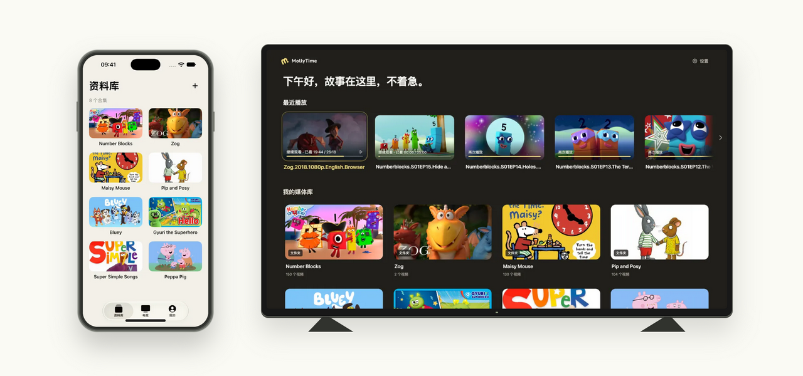

<div align="center">
  <picture>
    <source media="(prefers-color-scheme: dark)" srcset="assets/brand/mollytime-horizontal-on-dark.svg">
    
  </picture>
  <h1>A little home for the stories they love.</h1>
  <p>A family video library. Curated on your phone, enjoyed on the TV, with time to take a break.</p>
  <p><a href="README.md">简体中文</a> · <strong>English</strong> · <a href="README.ja.md">日本語</a></p>
  <p><a href="https://mollytime.app">Website</a> · <a href="#quick-start">Quick start</a> · <a href="#documentation">Documentation</a> · <a href="https://github.com/harunme/molly-time/issues">Feedback</a></p>
  <p>Android TV · iPhone / iPad · Android phones / tablets · Web</p>
</div>

---

Some stories get watched over and over. They deserve a place of their own.

**MollyTime** turns your family's cartoons, language-learning videos, and favorite stories into a library children can browse with a remote. Parents upload and organize content from a phone or browser, choose what appears on the TV, and agree on how many episodes—or minutes—fit into the day.

From “one more episode” to “let's save the rest for tomorrow,” MollyTime helps make watching together a little more relaxed.

## Take a look

<picture>
  <source media="(prefers-color-scheme: dark)" srcset="docs/readme/devices-dark.png">
  
</picture>

<sub>Screenshots show the Chinese interface. Programs and artwork shown are not included with the project and belong to their respective rights holders.</sub>

## Small details that matter at home

### You choose the library

Organize videos into collections, seasons, and episodes. Pick covers, arrange the order, and publish content when it is ready for your children. Unpublished items stay in the parent library. Family subtitle preferences include Chinese, English, bilingual Chinese–English, and off.

### Give a good story a good stopping point

Set a daily episode or minute allowance for each TV. Add a little extra time, end today's viewing, or let the current episode finish before a break. You can record your own reminder videos to make the transition more personal. Pausing and buffering do not count as viewing time; previews on a parent's phone do not use the child's TV allowance.

### Less waiting, less downloading again

A newly selected cover appears immediately while uploading and saving happen in the background. Playback preferences reuse prefetched data, and returning to the recycle bin keeps the previous list on screen. Mobile playback caches video ranges as they are read and reuses them on repeat viewing, reducing duplicate downloads and OSS egress. The TV also caches playback; capacity and cleanup policies are documented separately for each client.

### One family's library, or several independent families

Accounts, media, and devices are isolated by family. Pair a TV with a QR code or four-digit code. New families receive a default **5 GB storage allowance**, adjustable by a platform administrator. This is a limit, not preallocated disk space. Storage can use local disks or private OSS; existing families retain their previous limits when upgrading.

## What works today

| Use case | Available features |
| --- | --- |
| Organize a library | Collections, seasons, episodes, covers, ordering, publishing, hiding, recycle bin and restore |
| Upload content | Chunked or OSS multipart uploads, resumable transfers, task tracking, pause and retry |
| Watch on TV | Remote navigation, QR pairing, native Media3 playback, resume, subtitles and playback speed |
| Manage from a phone | Native iOS and Android parent apps for browsing, uploading, previews and TV management |
| Plan viewing | Per-TV daily episode / minute allowances, parent PIN, extra time and break reminders |
| Understand habits | Actual viewing time, viewing history, calendar heatmaps, content and device reports |
| Share between families | Share-code claims with server-side access and storage checks |
| Run the service | Invitations, users and family quotas, storage settings, usage reports, backups and client releases |

## From your library to the living room

1. **Choose the content.** Upload videos you have the right to use, organize them, and make selected content available to your children.
2. **Pair the TV.** Open the TV client, scan its QR code or enter its four-digit code from the parent app, and confirm the connection.
3. **Let them explore.** Children browse with the remote. Parents can set daily viewing rules and check viewing history from a phone or browser.

The official service uses invitation-based registration. For self-hosting, start with the parent web app and TV client. Current mobile apps default to the official service and do not offer a server-address editor on the login screen; using them with a self-hosted instance requires changing the client configuration and building your own app.

## Quick start

This is the **macOS / Linux local development** workflow. Install Python 3.11+, Node.js 22, pnpm 10, FFmpeg / FFprobe, `make`, and `lsof`. Native app build requirements are in the individual client guides.

```bash
git clone https://github.com/harunme/molly-time.git
cd molly-time

# Install API and web dependencies
make build-server
pnpm --dir apps/tv/web install --frozen-lockfile
pnpm --dir apps/web install --frozen-lockfile
pnpm --dir apps/site install --frozen-lockfile

# Create the first local family and platform admin; replace both values
export MOLLYTIME_INITIAL_ADMIN_EMAIL='you@example.com'
export MOLLYTIME_INITIAL_ADMIN_PASSWORD='change-this-before-use'
make init

# Start the API, TV web app, parent web app, and website
make dev
```

| Entry point | Local address |
| --- | --- |
| Parent web app | <http://127.0.0.1:5174/manage/> |
| TV interface preview | <http://127.0.0.1:5173/tv/> |
| Website preview | <http://127.0.0.1:4321/> |
| API | <http://127.0.0.1:8096> |

Sign in to the parent web app with the email and password you configured. `make dev` stops processes listening on these development ports. To keep an existing service running, start the components separately with `make server`, `make tv`, `make web`, and `make site`. The browser previews library browsing and remote interactions; test the full TV playback experience in the TV client.

Routine web development does not require Docker, an Android emulator, or a mobile app. Run `make` for the command list. See the [server guide](docs/server.md) and [OSS guide](docs/oss-storage.md) for production setup, HTTPS, databases, and storage.

## Built to be explored and improved

The web apps, native clients, and media backend live in one repository. A single FastAPI service provides the business logic through its own REST API; running a separate Jellyfin server is not required.

| Component | Stack | Source |
| --- | --- | --- |
| TV interface | React · TypeScript · Vite · remote focus navigation | [`apps/tv/web`](apps/tv/web) |
| Native TV client | Kotlin · WebView · Media3 | [`apps/tv/client`](apps/tv/client) |
| iOS parent app | SwiftUI · AVPlayer, iOS / iPadOS 17+ | [`apps/ios`](apps/ios) |
| Android parent app | Kotlin · Jetpack Compose, Android 8+ | [`apps/android`](apps/android) |
| Parent web app | React · TypeScript | [`apps/web`](apps/web) |
| API and media backend | FastAPI · SQLAlchemy · SQLite / MySQL | [`apps/server`](apps/server) |
| Public website | Astro | [`apps/site`](apps/site) |

The TV web bundle ships inside the APK, supports verified updates, and retains a fallback version. Native clients and the server coordinate uploads, playback caching, device credentials, and viewing-time accounting. Architecture notes and validation records live alongside the code.

## Scope and availability

- **Bring your own content.** MollyTime provides organization and playback tools. It does not include a video catalog; use content you are entitled to use.
- **Device compatibility is still growing.** Emulators and some physical devices have been tested. Specific TVs such as the Huawei V65, remotes, and codecs still need device testing; compatibility with every Android / HarmonyOS device is not guaranteed.
- **Caching still involves connectivity.** Cache hits reduce repeated transfers, but initial authorization, synchronization, and some playback checks require a connection. Playback caching is not a complete offline-library feature.
- **Viewing allowances are per TV.** There is currently no shared viewing-time pool across a family's TVs or separate allowance per child. Daily allowances reset at midnight in Asia/Shanghai (UTC+8). Storage allowances are shared by the family.
- **Source and releases may differ.** This README describes the current repository. The live service and installed clients may lag behind it. Building and installing the iOS app requires Xcode signing; Android build and distribution details are in the client guides.

## Documentation

| Goal | Start here |
| --- | --- |
| Use the parent dashboard | [Parent web app](apps/web/README.md) |
| Build the TV client | [TV client](apps/tv/client/README.md) · [TV web app](apps/tv/web/README.md) |
| Build a mobile app | [iOS / iPadOS](apps/ios/README.md) · [Android](apps/android/README.md) |
| Set viewing rules and reminders | [Viewing allowances](docs/watch-control.md) · [Parent video reminders](docs/parent-reminders.md) |
| Configure the backend and storage | [Server](docs/server.md) · [OSS and caching](docs/oss-storage.md) |
| Explore sharing, usage, and updates | [Content sharing](docs/content-sharing.md) · [Family usage](docs/family-usage.md) · [APK updates](docs/tv-client-updates.md) |
| Explore the brand and project origins | [Brand assets](assets/brand/mollytime-flower/README.md) · [Upstream source notes](docs/upstream.md) |

Most detailed technical documentation is currently in Chinese. Contributions to English and Japanese documentation are welcome.

## Help make it better

Share your experience, report a problem, or suggest an improvement through [Issues](https://github.com/harunme/molly-time/issues). For TV issues, include the device model, OS version, client version, and reproduction steps. Remove account details, tokens, and private media URLs before attaching logs or screenshots.

Feature improvements, device compatibility, accessibility, translations, and documentation are all welcome. Focused contributions with a clear problem statement and validation notes are especially helpful.

## Licenses and acknowledgments

Licensing is component-specific. The server declares MIT in [its README](apps/server/README.md). `apps/tv/` retains the Jellyfin Android TV upstream source and [GPL-2.0 license](apps/tv/LICENSE). Follow the applicable notices for other directories, assets, and dependencies, and retain the required copyright and license notices when distributing them.

Thank you to Jellyfin Android TV and the people behind React, FastAPI, Media3, SwiftUI, Jetpack Compose, and the other tools this project is built with.

---

<div align="center">
  <strong>Keep the stories. Make time for the moments.</strong><br>
  <sub>If MollyTime feels right for your family, a Star can help another family find it.</sub>
</div>
