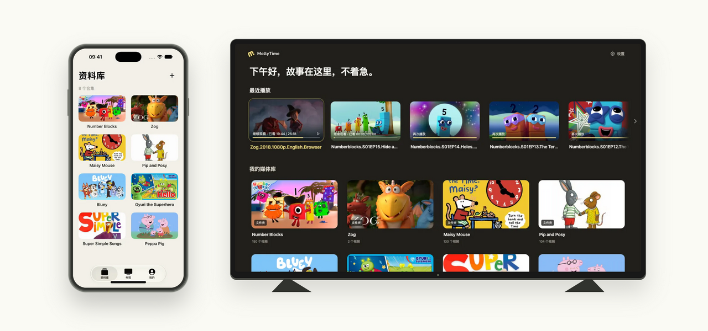

<div align="center">
  <picture>
    <source media="(prefers-color-scheme: dark)" srcset="assets/brand/mollytime-horizontal-on-dark.svg">
    
  </picture>
  <h1>お気に入りの物語に、家族だけの居場所を。</h1>
  <p>スマホで選んで、テレビで楽しむ。お休みの時間まで考えた、家族の動画ライブラリ。</p>
  <p><a href="README.md">简体中文</a> · <a href="README.en.md">English</a> · <strong>日本語</strong></p>
  <p><a href="https://mollytime.app">公式サイト</a> · <a href="#クイックスタート">クイックスタート</a> · <a href="#ドキュメント">ドキュメント</a> · <a href="https://github.com/harunme/molly-time/issues">ご意見・不具合報告</a></p>
  <p>Android TV · iPhone / iPad · Android スマホ / タブレット · Web</p>
</div>

---

何度も見たくなる物語を、家族の本棚に並べるように。

**MollyTime** は、アニメや語学学習の動画、親子で楽しむ作品をまとめて、子どもがリモコンで選べる動画ライブラリにするプロジェクトです。保護者はスマホやブラウザから動画をアップロード・整理し、テレビに表示する内容と、毎日見る話数や時間を設定できます。

「あと1話」から「続きはまた明日」まで。テレビを囲む時間が、少し穏やかになることを目指しています。

## 画面を見る

<picture>
  <source media="(prefers-color-scheme: dark)" srcset="docs/readme/devices-dark.png">
  
</picture>

<sub>画像は中国語版の画面です。表示されている番組・カバー画像は本プロジェクトに付属しません。著作権は各権利者に帰属します。</sub>

## 家庭で使うための、小さな工夫

### 何を見るかは、家族で決める

動画をコレクション・シーズン・エピソードに整理し、カバーや順番を整えてから子ども向けに公開できます。未公開の動画は保護者側に残り、テレビには公開を許可したライブラリが表示されます。字幕の標準設定は家族で共有でき、中国語・英語・中国語と英語の併記・字幕なしを選べます。

### 物語の終わりに、ひと息つけるように

テレビごとに、1日の話数または視聴時間を設定できます。少しだけ追加する、今日の視聴を終える、今の1話を見終わってから休む、といった操作にも対応。保護者が録画した動画を休憩の声かけに使うこともできます。一時停止やバッファリングは実際の視聴時間に含めず、保護者がスマホでプレビューしても子どもの視聴枠は減りません。

### 待ち時間も、繰り返しのダウンロードも減らす

選んだカバーはすぐに表示し、アップロードと保存はバックグラウンドで進めます。再生設定は事前取得したキャッシュを利用し、ごみ箱に戻ったときも前の一覧を保持します。モバイル再生では読み込んだ動画部分をキャッシュして再利用し、再視聴時のダウンロードや OSS の外向き通信量を抑えます。テレビにも再生キャッシュがあり、容量と削除方針は各クライアントの文書で説明しています。

### ひとつの家族にも、複数の独立した家族にも

アカウント・動画・デバイスは家族単位で分離されます。テレビは QR コードまたは4桁のコードで登録。新しい家族の保存容量は標準で **5 GB** とし、プラットフォーム管理者が個別に変更できます。容量は上限値であり、あらかじめディスクを確保するものではありません。ローカルディスクと非公開の OSS に対応し、既存の家族はアップグレード後も従来の上限を引き継ぎます。

## 現在できること

| 場面 | 対応している機能 |
| --- | --- |
| ライブラリの整理 | コレクション・シーズン・エピソード、カバー、並べ替え、公開・非公開、ごみ箱と復元 |
| 動画のアップロード | 分割転送、OSS マルチパート転送、中断からの再開、タスク確認、一時停止・再試行 |
| テレビでの視聴 | リモコン操作、QR 登録、Media3 によるネイティブ再生、続きから再生、字幕・再生速度 |
| スマホからの管理 | iOS / Android ネイティブアプリでの閲覧、アップロード、プレビュー、テレビ管理 |
| 視聴の約束 | テレビごとの1日の話数・時間、保護者 PIN、追加視聴、休憩リマインダー |
| 視聴習慣の確認 | 実際の視聴時間、履歴、カレンダーヒートマップ、動画別・デバイス別の統計 |
| 家族間での共有 | 共有コードでの受け取り、サーバー側での権限・保存容量チェック |
| サービスの運用 | 招待登録、ユーザーと家族の保存容量、ストレージ設定、利用状況、バックアップ、アプリ配信 |

## 家族のテレビで見るまでの3ステップ

1. **動画を用意する。** 利用する権利のある動画をアップロードし、コレクションやカバーを整えて、子どもに公開する内容を選びます。
2. **テレビを登録する。** TV クライアントを開き、保護者のスマホから QR コードを読み取るか4桁のコードを入力して、登録を確認します。
3. **視聴を楽しむ。** 子どもはリモコンで作品を選びます。保護者は必要に応じて毎日のルールを設定し、スマホやブラウザから履歴を確認できます。

公式サービスは招待制です。セルフホストする場合は、保護者向け Web アプリと TV クライアントから利用できます。現在のモバイルアプリは公式サービスへの接続が標準で、ログイン画面にサーバーアドレスの編集機能はありません。自分のサーバーに接続するには、クライアント設定を変更してビルドする必要があります。

## クイックスタート

以下は **macOS / Linux でのローカル開発**手順です。Python 3.11+、Node.js 22、pnpm 10、FFmpeg / FFprobe、`make`、`lsof` を用意してください。ネイティブアプリのビルド要件は各クライアントの文書をご覧ください。

```bash
git clone https://github.com/harunme/molly-time.git
cd molly-time

# API と Web アプリの依存関係をインストール
make build-server
pnpm --dir apps/tv/web install --frozen-lockfile
pnpm --dir apps/web install --frozen-lockfile
pnpm --dir apps/site install --frozen-lockfile

# 最初の家族とプラットフォーム管理者を作成。自分の値に置き換えてください
export MOLLYTIME_INITIAL_ADMIN_EMAIL='you@example.com'
export MOLLYTIME_INITIAL_ADMIN_PASSWORD='change-this-before-use'
make init

# API、TV Web、保護者 Web、公式サイトの開発サーバーを起動
make dev
```

| 用途 | ローカル URL |
| --- | --- |
| 保護者向け Web アプリ | <http://127.0.0.1:5174/manage/> |
| テレビ画面のプレビュー | <http://127.0.0.1:5173/tv/> |
| 公式サイトのプレビュー | <http://127.0.0.1:4321/> |
| API | <http://127.0.0.1:8096> |

設定したメールアドレスとパスワードで保護者向け Web アプリにログインします。`make dev` は、上記の開発用ポートを使用中の待ち受けプロセスを停止します。既存サービスを残したい場合は、`make server`、`make tv`、`make web`、`make site` で個別に起動してください。ブラウザではライブラリやリモコン操作を確認でき、テレビでの再生全体は TV クライアントで検証します。

日常の Web 開発では Docker、Android エミュレーター、モバイルアプリの起動は不要です。コマンド一覧は `make` で確認できます。本番環境、HTTPS、データベース、ストレージの設定は[サーバー文書](docs/server.md)と [OSS 文書](docs/oss-storage.md)をご覧ください。

## 仕組みを知って、育てていく

Web アプリ、ネイティブクライアント、メディアバックエンドをひとつのリポジトリで管理しています。業務ロジックは FastAPI の単一サービスにまとめ、独自の REST API を使用。別途 Jellyfin サーバーを動かす必要はありません。

| コンポーネント | 技術 | ソース |
| --- | --- | --- |
| テレビ画面 | React · TypeScript · Vite · リモコンのフォーカス移動 | [`apps/tv/web`](apps/tv/web) |
| TV ネイティブクライアント | Kotlin · WebView · Media3 | [`apps/tv/client`](apps/tv/client) |
| iOS 保護者アプリ | SwiftUI · AVPlayer、iOS / iPadOS 17+ | [`apps/ios`](apps/ios) |
| Android 保護者アプリ | Kotlin · Jetpack Compose、Android 8+ | [`apps/android`](apps/android) |
| 保護者向け Web アプリ | React · TypeScript | [`apps/web`](apps/web) |
| API・メディアバックエンド | FastAPI · SQLAlchemy · SQLite / MySQL | [`apps/server`](apps/server) |
| 公式サイト | Astro | [`apps/site`](apps/site) |

TV 用の Web バンドルは APK に同梱し、検証済みの更新と旧版へのフォールバックに対応します。アップロード、再生キャッシュ、デバイス認証情報、視聴時間の計測は、ネイティブクライアントとサーバーが連携して処理します。構成や検証記録もリポジトリにまとめています。

## 対応範囲と提供状況

- **動画はご自身で用意してください。** 本プロジェクトは管理・再生ツールであり、動画コンテンツは付属しません。利用する権利のあるコンテンツを使用してください。
- **実機対応は引き続き改善中です。** エミュレーターと一部の実機で検証しています。Huawei V65 など個別のテレビ、リモコン、コーデックは実機確認が必要で、すべての Android / HarmonyOS 端末での動作を保証するものではありません。
- **キャッシュがあっても通信が必要な場面があります。** 初回認証、同期、一部の再生チェックには接続が必要です。再生キャッシュは完全なオフラインライブラリではありません。
- **視聴枠はテレビごとです。** 家族の複数テレビで共有する時間枠や、子ども別の枠は現在ありません。1日の視聴枠は中国標準時（Asia/Shanghai、UTC+8）の午前0時に更新します。保存容量は家族で共有します。
- **ソースと配信版には差がある場合があります。** この README は現在のリポジトリを説明しています。公開サービスやインストール済みのアプリに、最新の変更がまだ反映されていないことがあります。iOS のビルド・インストールには Xcode での署名が必要です。Android のビルド・配信については各文書をご覧ください。

## ドキュメント

| やりたいこと | 参照先 |
| --- | --- |
| 保護者向け管理画面を使う | [保護者 Web](apps/web/README.md) |
| TV クライアントをビルドする | [TV クライアント](apps/tv/client/README.md) · [TV Web](apps/tv/web/README.md) |
| モバイルアプリをビルドする | [iOS / iPadOS](apps/ios/README.md) · [Android](apps/android/README.md) |
| 視聴ルールとリマインダーを設定する | [視聴枠](docs/watch-control.md) · [保護者の動画リマインダー](docs/parent-reminders.md) |
| サーバーとストレージを設定する | [サーバー](docs/server.md) · [OSS とキャッシュ](docs/oss-storage.md) |
| 共有・利用状況・更新を知る | [コンテンツ共有](docs/content-sharing.md) · [家族の利用状況](docs/family-usage.md) · [APK 更新](docs/tv-client-updates.md) |
| ブランドと由来を知る | [ブランド素材](assets/brand/mollytime-flower/README.md) · [上流ソースの記録](docs/upstream.md) |

詳細な技術文書の多くは現在中国語です。英語・日本語の文書整備へのご協力も歓迎します。

## 一緒に、もっと使いやすく

使ってみた感想、不具合、ご提案は [Issues](https://github.com/harunme/molly-time/issues) へお寄せください。テレビの問題では、機種、OS、クライアントのバージョン、再現手順があると調査しやすくなります。ログやスクリーンショットからは、アカウント情報、トークン、非公開メディアの URL を取り除いてください。

機能改善、端末対応、アクセシビリティ、翻訳、文書整備など、さまざまな形で参加できます。解決する問題と確認方法を添えた、小さく焦点の合った変更を歓迎します。

## ライセンスと謝辞

ライセンスはコンポーネントごとに異なります。サーバーは[自身の README](apps/server/README.md)で MIT を宣言しています。`apps/tv/` には Jellyfin Android TV の上流ソースと [GPL-2.0 ライセンス](apps/tv/LICENSE) を保持しています。その他のディレクトリ、素材、依存ライブラリはそれぞれの表示に従い、配布時には必要な著作権表示とライセンスを保持してください。

Jellyfin Android TV をはじめ、React、FastAPI、Media3、SwiftUI、Jetpack Compose など、プロジェクトを支える技術の開発者の皆さまに感謝します。

---

<div align="center">
  <strong>好きな物語と、家族の時間を大切に。</strong><br>
  <sub>MollyTime がご家庭に合いそうだと感じたら、Star で応援していただけるとうれしいです。</sub>
</div>
