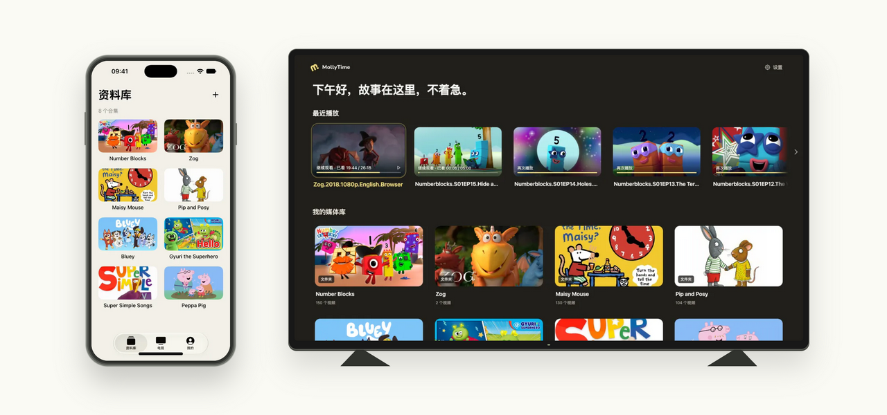

<div align="center">
  <picture>
    <source media="(prefers-color-scheme: dark)" srcset="assets/brand/mollytime-horizontal-on-dark.svg">
    
  </picture>
  <h1>把好故事留给孩子，把选择权交给家长。</h1>
  <p>一个为家庭打造的视频库：在手机整理，在电视观看，按约定休息。</p>
  <p><strong>简体中文</strong> · <a href="README.en.md">English</a> · <a href="README.ja.md">日本語</a></p>
  <p><a href="https://mollytime.app">官网</a> · <a href="#快速开始">快速开始</a> · <a href="#文档导航">技术文档</a> · <a href="https://github.com/harunme/molly-time/issues">反馈与建议</a></p>
  <p>Android TV · iPhone / iPad · Android 手机 / 平板 · Web</p>
</div>

---

孩子喜欢的故事，值得有一个专门的地方。

**MollyTime** 把家里的动画、英语启蒙视频和亲子内容整理成孩子可以用遥控器自己选择的片库。家长在手机或网页上挑选、上传、整理，决定哪些内容可以看，也可以约定每天看几集、看多久。

从“再看一集”到“今天先到这里”，MollyTime 希望让每一次打开电视，都更从容一点。

## 先看一眼

<picture>
  <source media="(prefers-color-scheme: dark)" srcset="docs/readme/devices-dark.png">
  
</picture>

<sub>界面示例。截图中的节目与封面不随项目提供，版权归各自权利人所有。</sub>

## 为家庭认真打磨的细节

### 片单，由你决定

把视频整理成合集、季和单集，自定义封面、调整顺序，准备好了再开放给孩子。尚未发布的内容留在家长端，电视展示家长允许观看的片库。字幕支持中文、英文、中英文与关闭选项，默认偏好在家庭内共享。

### 休息，也可以有好的结束方式

为每台电视设置每天的集数或分钟数，支持临时加看、结束今日观看，以及“这一集看完就休息”。可以用家长录制的提醒视频告诉孩子：好故事明天继续。暂停和缓冲不计入实际观看时长，家长在手机上的预览也不占孩子的观看额度。

### 管理时少等一点，重播时少下载一点

封面选好就显示，后台完成上传与保存；播放偏好复用预取缓存，返回回收站保留已有列表。手机视频按需缓存已播放的片段，再看时优先复用，减少重复下载与 OSS 公网流量。电视也有播放缓存，具体容量和清理策略见各端文档。

### 从一个家庭，到多个独立家庭

账号、片库和设备按家庭隔离，电视通过二维码或四位码绑定。新家庭默认有 **5 GB 空间额度**，超管可在用户管理中单独调整；这是容量上限，不会预先占用实际存储。支持本地磁盘或私有 OSS，已有家庭升级时保留原额度。

## 已经可以做什么

| 场景 | 当前能力 |
| --- | --- |
| 整理片库 | 合集 / 季 / 单集、封面、排序、发布与隐藏、回收站与恢复 |
| 上传内容 | 分块或 OSS 分片上传、断点续传、上传任务、暂停与重试 |
| 电视观看 | 遥控器导航、扫码绑定、原生 Media3 播放、续播、字幕与播放速度 |
| 手机管理 | 原生 iOS 与 Android 家长端，浏览、上传、预览和电视管理 |
| 观看安排 | 按电视设置每日集数 / 分钟、家长 PIN、加看、休息提醒 |
| 了解习惯 | 实际观看时长、观看记录、日历热力图、内容与设备统计 |
| 家庭间分享 | 通过分享码领取内容，服务端检查访问权限与空间额度 |
| 平台运营 | 邀请注册、用户与家庭额度、存储配置、用量统计、备份和客户端发布 |

## 三步，把片库搬上电视

1. **准备内容**：家长登录后上传自己有权使用的视频，整理合集与封面，选择允许孩子观看的内容。
2. **绑定电视**：打开 TV 客户端，用家长手机扫描二维码或输入四位码，确认绑定。
3. **开始观看**：孩子用遥控器选片；家长可按需要设置每日安排，并在手机或网页查看记录。

官方服务通过邀请码注册。自部署可先使用家长网页和 TV 客户端；当前手机端默认连接官方服务，登录页不提供修改服务地址的入口，连接自部署服务需调整客户端配置并自行构建。

## 快速开始

以下是 **macOS / Linux 本地开发**流程。准备 Python 3.11+、Node.js 22、pnpm 10、FFmpeg / FFprobe，以及 `make`、`lsof`。原生 App 构建工具见各端文档。

```bash
git clone https://github.com/harunme/molly-time.git
cd molly-time

# 安装服务端和网页依赖
make build-server
pnpm --dir apps/tv/web install --frozen-lockfile
pnpm --dir apps/web install --frozen-lockfile
pnpm --dir apps/site install --frozen-lockfile

# 首次创建本地家庭与超管；替换为自己的邮箱和密码
export MOLLYTIME_INITIAL_ADMIN_EMAIL='you@example.com'
export MOLLYTIME_INITIAL_ADMIN_PASSWORD='change-this-before-use'
make init

# 同时启动 API、TV 网页、家长网页和官网
make dev
```

| 入口 | 本地地址 |
| --- | --- |
| 家长管理网页 | <http://127.0.0.1:5174/manage/> |
| 电视界面预览 | <http://127.0.0.1:5173/tv/> |
| 官网预览 | <http://127.0.0.1:4321/> |
| API | <http://127.0.0.1:8096> |

使用初始化时设置的邮箱和密码登录家长网页。`make dev` 会停止占用上述开发端口的监听进程；如需保留已有服务，可分别运行 `make server`、`make tv`、`make web`、`make site`。网页预览支持目录与遥控器交互，完整电视播放通过 TV 客户端验证。

日常网页开发无需启动 Docker、Android 模拟器或手机客户端。`make` 可查看命令列表；生产部署、HTTPS、数据库与存储配置见[服务端文档](docs/server.md)和 [OSS 配置](docs/oss-storage.md)。

## 为想继续打磨它的人

MollyTime 的网页、原生客户端与媒体后台放在同一仓库。业务由一个 FastAPI 后台提供，使用自有 REST API，无需额外运行 Jellyfin 服务。

| 模块 | 技术 | 入口 |
| --- | --- | --- |
| 电视界面 | React · TypeScript · Vite · 遥控器焦点导航 | [`apps/tv/web`](apps/tv/web) |
| TV 原生客户端 | Kotlin · WebView · Media3 | [`apps/tv/client`](apps/tv/client) |
| iOS 家长端 | SwiftUI · AVPlayer，iOS / iPadOS 17+ | [`apps/ios`](apps/ios) |
| Android 家长端 | Kotlin · Jetpack Compose，Android 8+ | [`apps/android`](apps/android) |
| 家长管理后台 | React · TypeScript | [`apps/web`](apps/web) |
| 业务与媒体服务 | FastAPI · SQLAlchemy · SQLite / MySQL | [`apps/server`](apps/server) |
| 官网 | Astro | [`apps/site`](apps/site) |

电视网页包随 APK 内置，可在校验后更新，并保留回退版本。手机上传、播放缓存、设备凭据和观看计时由原生端与服务端配合处理。架构、边界和验证记录均保留在仓库，方便继续研究和改进。

## 使用范围

- **内容自备**：项目提供管理与播放工具，不附带影视资源。请使用有权使用的内容。
- **适配仍在完善**：已有模拟器与部分真机验证；华为 V65 等具体电视、遥控器和视频编码需实机确认，不承诺所有 Android / HarmonyOS 设备通用。
- **缓存与网络**：命中缓存可减少重复传输；首次授权、同步和部分播放校验仍需网络，不能把播放缓存当成完整的离线片库。
- **观看额度按电视计算**：目前不提供家庭多电视共用的观看时间池或每个儿童单独的额度。每日观看额度按北京时间（Asia/Shanghai，UTC+8）零点恢复。空间额度则按家庭共享。
- **源码与发行版**：本文描述当前仓库，线上服务和已安装客户端可能晚于源码。iOS 安装需 Xcode 签名；Android 出包与发布方式见各端说明。

## 文档导航

| 想做的事 | 从这里开始 |
| --- | --- |
| 使用家长后台 | [网页家长端](apps/web/README.md) |
| 构建电视客户端 | [TV 客户端](apps/tv/client/README.md) · [TV 网页](apps/tv/web/README.md) |
| 构建手机端 | [iOS / iPadOS](apps/ios/README.md) · [Android](apps/android/README.md) |
| 配置每日观看与提醒 | [观看安排](docs/watch-control.md) · [家长视频提醒](docs/parent-reminders.md) |
| 配置服务与存储 | [服务端](docs/server.md) · [OSS 与缓存](docs/oss-storage.md) |
| 了解分享、用量与更新 | [内容分享](docs/content-sharing.md) · [家庭用量](docs/family-usage.md) · [APK 更新](docs/tv-client-updates.md) |
| 了解品牌与来源 | [品牌资源](assets/brand/mollytime-flower/README.md) · [上游源码记录](docs/upstream.md) |

多数深入的技术文档目前使用中文。欢迎帮助完善英文和日文文档。

## 一起把它做好

欢迎通过 [Issues](https://github.com/harunme/molly-time/issues) 分享使用体验、报告问题或提出建议。电视相关问题请带上设备型号、系统版本、客户端版本和复现步骤；截图与日志请先移除账号、令牌和私人媒体地址。

功能改进、设备兼容、无障碍体验、翻译和文档都值得参与。欢迎提交聚焦的小改动，并说明解决了什么问题、如何验证。

## 许可与致谢

许可按目录区分：服务端在[自身说明](apps/server/README.md)中声明采用 MIT；`apps/tv/` 保留 Jellyfin Android TV 上游源码与 [GPL-2.0 许可证](apps/tv/LICENSE)。其他目录、素材和依赖请遵循各自的许可声明，分发时一并保留相关版权与许可证。

感谢 Jellyfin Android TV 上游，以及 React、FastAPI、Media3、SwiftUI、Jetpack Compose 等项目与工具的建设者。

---

<div align="center">
  <strong>把好时光，慢慢收藏。</strong><br>
  <sub>如果 MollyTime 也适合你的家庭，欢迎留一颗 Star，让更多人发现它。</sub>
</div>
