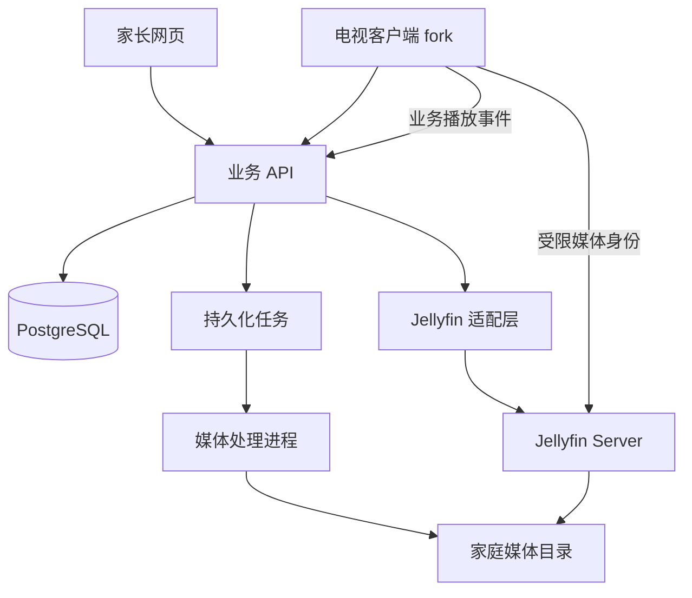

# Molly TV 产品与架构方案

日期：2026-10-11

状态：已确定方向；开源版本、客户端扩展点和设备兼容性待技术验证。本文不表示已经完成安装或开发。

## 1. 目标与原则

先服务家中的华为智慧屏，再扩展为多家庭儿童视频平台。优先复用成熟开源软件的播放、字幕、解码、遥控器和媒体服务能力，把主要开发投入放在家庭、儿童档案、上传、首页和观看统计。

最终方向：Jellyfin Server 负责媒体能力；基于 Jellyfin Android TV 修改电视业务界面；独立家长网页与业务后台负责产品逻辑。Just Player 作为播放适配的参考和实机对照，不与现有播放器整套并行引入。

第一阶段不开发 iPhone、CarPlay、投屏、公共资源分享、付费系统或严格离线限时。不能将下载资源自动视为可对外分发资源；默认资源为家庭私有，开放共享另行设计。

## 2. 已知环境

| 项目 | 当前信息 |
| --- | --- |
| 电视 | 华为智慧屏 V65，HD65THAA，2021 款 |
| 系统 | HarmonyOS 4.3.0.130 |
| 硬件 | HongHu818、4GB 内存、64GB 存储、3840×2160 |
| 资源目录 | `downloads/bbkt` |
| 资源快照 | 203 个 MP4、3346 个 SRT、655 张图片，总计约 6.74 GiB |
| Mac 工具 | 常见位置未发现 Android Studio 或 Android SDK，需进一步检查并配置 |

目录包含只有字幕或封面的条目。扫描结果是文件数量，不是已验证可播放的剧集数量。导入只发布存在有效视频的剧集，缺失或匹配不明确的内容进入待处理清单。

华为官方提供 U 盘安装第三方应用流程，但自定义 APK 在该设备上的安装、启动和播放仍须实测。Android TV 模拟器不能替代 HarmonyOS 实机验证。

## 3. 用户流程

### 电视端

1. 展示设备绑定二维码，家长登录网页后确认绑定。
2. 选择儿童头像，加载对应首页。
3. 使用方向键、确定键和返回键浏览分类、系列和剧集。
4. 播放、暂停、快进退、选字幕、倍速、下一集与续播。
5. 上传播放事件，展示儿童自己的观看进度。

### 家长网页

1. 管理家庭成员、儿童档案和电视设备。
2. 上传视频、封面及字幕，查看处理结果。
3. 调整分类、系列和剧集顺序，指定儿童可看内容。
4. 配置首页栏目、置顶内容及隐藏内容。
5. 查看每日、每周播放时长和观看历史。

## 4. 开源复用边界

| 项目 | 复用方式 | 边界 |
| --- | --- | --- |
| Jellyfin Server | 优先使用未经修改的固定版本，通过 API 集成 | 媒体扫描、媒体元数据、播放信息、按需转码与媒体权限 |
| Jellyfin Android TV | 建立 fork，保留成熟播放链路，新增业务模块 | 家庭绑定、儿童选择、自定义首页、业务资源到媒体条目的映射、统计事件 |
| Just Player | 使用现成 APK 对照，针对实测问题参考或移植实现 | 外置字幕、文件访问、解码及播放控制适配；不默认替换整套播放器 |
| Playback Reporting | 可选安装作辅助诊断 | 不作为产品观看统计唯一来源 |

不能假设客户端播放实现可以直接抽成独立 SDK。先阅读选定版本代码，找到最小改动入口；首页能否直接调用已有详情和播放流程由原型验证。

复用前固定 tag/commit、记录仓库、许可证、依赖与本地修改。分发修改后的 APK 前核对所选版本的源码提供、版权声明等义务。不得因把业务代码放在不同目录就假设其独立于上游许可证。许可证评估包含移植代码及原生解码依赖。

## 5. 架构与职责

业务后台采用模块化单体，媒体处理独立进程运行。不提前拆微服务。建议技术栈：React + TypeScript 家长网页、FastAPI 业务 API、PostgreSQL、Jellyfin Server、Kotlin 电视 fork。具体版本在环境与上游构建验证时锁定。

### 数据所有权

| 数据 | 唯一权威来源 |
| --- | --- |
| 账号、家庭、角色、儿童、设备 | 业务数据库 |
| 上传归属、业务分类、剧集顺序、首页 | 业务数据库 |
| 业务资源 ID 与媒体 ID 的对应 | 业务数据库中的适配映射 |
| 媒体技术信息、扫描结果、转码与播放能力 | Jellyfin |
| 产品续播进度、观看事件与报表 | 业务数据库 |

Jellyfin 内置进度可继续用于播放器内部行为，但不得与业务进度双向自由合并。客户端进入业务剧集时读取业务续播位置；播放结束后更新业务进度。具体调用路径必须在 fork 中验证。

## 6. 身份与家庭隔离

家庭是资源隔离边界，儿童是首页、内容访问与统计边界。

- 业务用户通过家庭成员关系获得 owner/parent 等权限；儿童档案没有独立成人登录凭证。
- 资源、设备、配置、事件及上传均有明确家庭归属。后台由认证身份推导权限，不信任请求中的家庭 ID。
- 设备使用短期绑定挑战：过期、单次使用、家长确认后签发可撤销的设备凭证。扫描二维码本身不完成绑定。
- 业务数据库保存儿童与 Jellyfin 受限媒体身份的映射。默认每个儿童映射独立媒体用户，禁止使用管理员令牌播放。
- 每个家庭使用独立媒体目录和媒体库。儿童媒体身份只获准访问相应媒体库，禁用管理与删除权限。
- 业务内容授权必须同步落实到媒体层。仅在首页隐藏内容不等于禁止播放。儿童若仅能访问家庭库中的部分内容，需验证 Jellyfin 能否可靠表达该限制；否则改用独立授权媒体代理或更细的库划分。
- 普通用户不直接使用 Jellyfin 管理后台；媒体凭证只按验证后的受限流程发给客户端，不放入二维码、日志或首页配置。

多家庭发布前必须验证：其他家庭的列表、媒体详情、视频、字幕、封面、下载、转码端点均不可访问；使用已知媒体 ID 也不可越权。受限媒体令牌的实际有效期、注销和撤销机制须验证，不能预设为短期签名 URL。

如果原生权限无法满足以上边界，媒体请求进入业务授权代理；代理必须覆盖文件 Range、字幕、封面以及 HLS 清单与片段。此项作为验证后的决策，不把两条路径同时实现。

## 7. 资源模型与导入

核心模型：`User`、`Family`、`FamilyMember`、`ChildProfile`、`Device`、`Category`、`Series`、`Episode`、`MediaAsset`、`MediaMapping`、`UploadSession`、`HomeConfig`、`PlaybackSession`、`PlaybackEvent`、`PlaybackProgress`。

剧集业务 ID 独立于文件路径和 Jellyfin ID。更换文件、移动目录或重新扫描不应丢失收藏与进度。媒体映射可重建，Jellyfin 数据库不作为业务数据库，也不直接修改其内部表。

导入流程：扫描目录 → 建立可重跑的导入清单 → 匹配视频/字幕/封面 → 检查编码与时长 → 人工处理歧义 → 创建业务条目 → 建立 Jellyfin 兼容目录及元数据 → 扫描 → 映射 → 发布。

保留原目录作为输入，不直接批量重命名源文件。以选定 Jellyfin 版本验证本地封面、字幕和元数据约定，避免儿童资源被外部影视刮削错误覆盖。外部元数据获取默认关闭，待确认后按库开启。

## 8. 上传与媒体处理

状态：`uploading → validating → processing → indexing → ready`；各阶段可进入 `failed`，删除进入独立清理流程。未达到 ready 的条目不向儿童展示。

上传初期先支持视频、封面、字幕的独立文件，不默认解压任意压缩包。后台使用生成的存储键，校验实际文件格式、大小与家庭额度。上传占用计入额度预留，取消或过期后释放。

媒体任务持久化、幂等、可重试，记录失败原因。完整文件先放暂存区，检查成功后发布，避免 Jellyfin 扫描到半个文件。扫描采用合并触发与周期性对账，不对每个小文件执行全库扫描。

复用 Jellyfin 转码，不另建同功能转码系统。FFmpeg 仅用于必要的输入检查、缩略图和针对实测问题的预处理。原视频可正常播放时不默认转码。字幕保留 SRT，先验证播放器及 Jellyfin 的实际匹配与切换。

第一阶段以 Jellyfin 可访问的本地文件系统存储媒体。对象存储不是它的透明替代：后续需验证挂载、本地缓存或独立媒体服务路径，并制定迁移方案后再接入。

## 9. 首页协议

首页配置包含 `schema_version`、`revision` 和有限的栏目类型，例如继续播放、系列列表、精选剧集。家长可排序、置顶和隐藏；不能下发任意 HTML 或执行代码。

后台过滤不可见资源。旧客户端忽略未知栏目并回退到安全默认首页；客户端保存上一份有效配置。上线初期默认配置即可，新协议与客户端版本兼容性需验证。

## 10. 播放进度与统计

产品统计的是客户端报告的播放时间，不宣称能证明孩子实际注视屏幕。

- 进度：当前媒体位置，供续播使用。
- 播放时长：正在播放时实际经过的时间，暂停、缓冲及拖动不计入；倍速时不按媒体位移直接计算。
- 事件：开始、播放心跳、暂停、拖动、结束、异常退出后的恢复，包含会话 ID、递增序号、儿童、设备、剧集、媒体位置与累计播放时间。
- 后台按会话与序号去重，用累计值增量避免重试重复计时，并校验异常增量。
- 网络短暂中断时本地持久化事件并补传。儿童切换结束当前会话，防止串档。
- 多设备续播按明确的会话更新规则处理，不能取最大播放位置；离线旧事件不得覆盖更新的在线进度。
- 每日汇总使用家庭时区，跨午夜分段；具体协议与时钟偏差处理在实现设计中固定。

Playback Reporting 仅用于对照诊断。每日限时另做授权与客户端执行，离线额度、多设备并发与撤销延迟在该功能上线前明确；首版不承诺严格离线限时。

## 11. Mac 与电视验证

Mac 使用 Android Studio、SDK、匹配机器架构的 Android TV 模拟器。先检查 Mac 芯片、可用空间与可用 TV 镜像，不预设某个系统镜像一定可用。后台与 Jellyfin 可原生或容器运行，安装方式根据实际环境确定。

| 环境 | 验证内容 |
| --- | --- |
| Mac 浏览器 | 登录、上传、儿童配置、首页与报表 |
| Mac 后台 | 权限、导入重试、扫描映射、事件去重 |
| TV 模拟器 | fork 构建、键盘方向/确定/返回操作、焦点、播放流程与业务页面 |
| 华为 V65 | APK 安装和入口、遥控器、画面声音、字幕、倍速、快进退、连续播放、休眠恢复、网络中断 |

先测试官方 Jellyfin Android TV APK 与 Just Player 对照 APK，再编译未修改的上游客户端，最后加入最小业务改动。记录版本、测试文件编码、操作、日志与结果。模拟器的媒体表现不能替代实机硬件解码结果。

选取有代表性的现有视频和字幕，先运行 ffprobe 得到实际格式。小内置样本仅用于独立播放诊断；主要原型验证电视访问 Mac 上的 Jellyfin，避免误把服务器架构当成纯离线 APK。

若 Mac 与电视联网调试可用，再采用 ADB；不能预设该智慧屏开放 ADB。无法使用时通过 U 盘安装和客户端诊断信息验证。

## 12. 分阶段交付与决策门槛

| 阶段 | 交付 | 通过条件 |
| --- | --- | --- |
| P0 开源与设备验证 | 固定版本清单、许可证清单、Mac 构建、官方 APK 对照、实机记录 | V65 能安装与正常播放；确认 fork 的首页到播放器扩展路径；双家庭媒体权限原型通过 |
| P1 单家庭业务原型 | 定制 TV APK、业务 API、导入工具、儿童头像、默认首页、续播 | 现有有效视频可导入并正确播放，儿童进度独立 |
| P2 家长管理 | 网页上传、处理状态、分类排序、首页配置、日周统计 | 家长可独立完成上传到电视播放，统计场景验证通过 |
| P3 多家庭试用 | 注册邀请、家庭隔离、额度、设备撤销、备份与部署文档 | 双家庭端到端越权检查通过；数据库/媒体/映射可恢复 |
| P4 后续能力 | 缓存下载、严格定义的限时、多设备同步增强、其他客户端 | 独立需求与兼容性验收完成 |

P0 不通过时不继续扩大业务改造。若 Jellyfin 客户端在 V65 不兼容，先定位安装、系统 API、解码或交互原因，对照 Just Player；有证据后选择小补丁、移植必要适配，或保留服务端并换客户端。不得仅凭一个播放失败立即重写全部链路。

## 13. 部署与维护

开发期 Mac 保存文件并运行服务，在线播放需要 Mac 常开且网络可达。长期家庭使用迁到常开主机或 NAS。多家庭期统一 HTTPS 入口，Jellyfin 管理接口限于管理员，媒体端点按上述权限方案开放。

备份业务数据库、媒体文件、Jellyfin 配置及身份映射，验证恢复后的权限与播放。记录上传、处理、扫描、授权及播放错误，避免在日志中保存访问令牌。部署前评估实际并发转码能力和带宽，不预设 Mac 或单台服务器足够支撑外部用户。

fork 固定上游基线，业务代码集中在独立包和适配接口中；播放器核心只为已复现的问题修改。升级先在模拟器和 V65 跑核心场景，再更新服务器和客户端。维护已知问题及对应上游链接，适合上游的通用修复另行提交。

建议后续目录：`apps/tv/`、`apps/parent-web/`、`services/business-api/`、`services/media-worker/`、`tools/import/`、`infra/`、`docs/`。只在实施对应模块时创建，不预先铺空架子。

## 14. 首批待验证事项

1. Mac 工具链、CPU 架构与 TV 模拟器镜像。
2. Jellyfin 服务端与 TV 客户端的兼容版本和构建要求。
3. V65 对现成 APK、修改后 APK 与现有视频编码的支持。
4. TV fork 自定义首页、儿童切换及调用现有播放流程的改动量。
5. 按家庭与儿童的媒体权限，以及令牌撤销和完整媒体端点隔离。
6. 本地儿童资源的目录、封面、字幕、元数据匹配规则。
7. 上游进度事件与业务续播、统计事件的接入位置。
8. 许可证、品牌替换、原生库 ABI 与分发要求。

## 15. 资料与判断分工

- [Jellyfin Server](https://github.com/jellyfin/jellyfin)
- [Jellyfin Android TV](https://github.com/jellyfin/jellyfin-androidtv)
- [Just Player](https://github.com/moneytoo/Player)
- [Jellyfin 用户管理](https://jellyfin.org/docs/general/server/users/)
- [Jellyfin 媒体库](https://jellyfin.org/docs/general/server/libraries/)
- [Jellyfin 插件及 Playback Reporting](https://jellyfin.org/docs/general/server/plugins/index.html)
- [Android TV 创建与运行](https://developer.android.com/training/tv/get-started/create)
- [Media3 设备兼容性](https://developer.android.com/media/media3/exoplayer/supported-devices)
- [华为智慧屏安装应用](https://consumer.huawei.com/cn/support/content/zh-cn15984796/)
- [华为第三方应用安装兼容性](https://consumer.huawei.com/cn/support/content/zh-cn15773624/)

权限、文件校验、资源映射、额度、事件去重与统计采用确定性代码。Codex 负责架构、开源代码分析、实现及调试。Jev usage: Not used；当前方案没有需要窄语义判断的功能，不引入 AI 依赖。
